# MEDICYCLE — Entity Relationship (ER) Model & Relationship Specifications

**System:** MEDICYCLE — Medicine Intelligence, Safety & Lifecycle Ecosystem  
**Database Name:** `medicycle_db`  
**Document Revision:** 2.0 (Phase 2 Expanded Relational Model)  
**File Location:** `database/docs/entity_relationships.md`  

---

## 1. Global Entity-Relationship Diagram

```mermaid
erDiagram
    categories ||--o{ medicines : "classifies (1:N)"
    manufacturers ||--o{ medicines : "produces (1:N)"
    source_references ||--o{ medicines : "cites (1:N)"
    source_references ||--o{ ingredients : "documents (1:N)"
    source_references ||--o{ medicine_uses : "validates (1:N)"
    source_references ||--o{ drug_interactions : "substantiates (1:N)"
    source_references ||--o{ disposal_guidelines : "authorizes (1:N)"
    source_references ||--o{ recall_records : "issues (1:N)"
    source_references ||--o{ safety_alerts : "verifies (1:N)"
    source_references ||--o{ environmental_impact_records : "evidences (1:N)"

    medicines ||--|{ medicine_compositions : "contains (1:N)"
    ingredients ||--|{ medicine_compositions : "comprises (1:N)"
    ingredients ||--o{ drug_interactions : "interacts_with_1 (1:N)"
    ingredients ||--o{ drug_interactions : "interacts_with_2 (1:N)"
    ingredients ||--o{ environmental_impact_records : "has_api_impact (1:N)"

    medicines ||--o{ medicine_uses : "prescribed_for (1:N)"
    medicines ||--|{ medicine_batches : "manufactured_into (1:N)"
    medicines ||--|| storage_rules : "governed_by (1:1)"
    medicines ||--o{ side_effects : "causes (1:N)"
    medicines ||--o{ contraindications : "prohibited_in (1:N)"
    medicines ||--|| disposal_guidelines : "regulated_by (1:1)"
    medicines ||--o{ safety_alerts : "receives_warning (1:N)"
    medicines ||--o{ environmental_impact_records : "measures_footprint (1:N)"
    medicines ||--o{ recall_medicines : "affected_by_recall (1:N)"
    medicines ||--o{ scan_records : "matched_in_scan (1:N)"

    medicine_batches ||--o{ recall_medicines : "targeted_in_recall (1:N)"
    medicine_batches ||--o{ scan_records : "verified_batch (1:N)"
    medicine_batches ||--o{ temperature_monitoring_logs : "monitored_under (1:N)"
    medicine_batches ||--o{ medicine_disposal_logs : "disposed_via (1:N)"

    recall_records ||--|{ recall_medicines : "includes_targets (1:N)"

    scan_records ||--o{ ocr_extraction_records : "produces_ocr (1:N)"

    users ||--o{ scan_records : "performs_scan (1:N)"
    users ||--o{ temperature_monitoring_logs : "logs_telemetry (1:N)"
    users ||--o{ medicine_disposal_logs : "certifies_destruction (1:N)"
    users ||--o{ audit_logs : "triggers_mutation (1:N)"

    users ||--o{ user_roles : "assigned_to (1:N)"
    roles ||--o{ user_roles : "grants_role (1:N)"
    roles ||--o{ role_permissions : "includes_permission (1:N)"
    permissions ||--o{ role_permissions : "authorized_by (1:N)"
```

---

## 2. Cardinality & Relationship Catalog

### 2.1 Core Clinical & Master Data Relationships

| Parent Entity | Child Entity | Cardinality | Join Keys | Relationship Name & Description | Referential Action |
|---|---|---|---|---|---|
| `categories` | `medicines` | $1 : N$ (One-to-Many) | `category_id` | **Classification:** Every medicine belongs to exactly one therapeutic category; a category groups multiple medicines. | `ON DELETE RESTRICT` |
| `manufacturers` | `medicines` | $1 : N$ (One-to-Many) | `manufacturer_id` | **Production:** A pharmaceutical manufacturer produces many medicines; each medicine is attributed to one primary legal manufacturer. | `ON DELETE RESTRICT` |
| `medicines` | `medicine_compositions` | $1 : N$ (One-to-Many) | `medicine_id` | **Active Composition:** A medicine is composed of one or more active or inactive chemical ingredients with exact dosages. | `ON DELETE CASCADE` |
| `ingredients` | `medicine_compositions` | $1 : N$ (One-to-Many) | `ingredient_id` | **Ingredient Usage:** An Active Pharmaceutical Ingredient (API) can be formulated across multiple medicines. | `ON DELETE RESTRICT` |
| `ingredients` | `drug_interactions` (Ing 1) | $1 : N$ (One-to-Many) | `ingredient1_id` | **Primary Drug Interaction:** The first active substance participating in a pharmacodynamic/pharmacokinetic interaction. | `ON DELETE RESTRICT` |
| `ingredients` | `drug_interactions` (Ing 2) | $1 : N$ (One-to-Many) | `ingredient2_id` | **Secondary Drug Interaction:** The second active substance interacting with the first substance. | `ON DELETE RESTRICT` |
| `medicines` | `medicine_uses` | $1 : N$ (One-to-Many) | `medicine_id` | **Clinical Indications:** A medicine has one or more approved clinical indications and target pathologies. | `ON DELETE CASCADE` |
| `medicines` | `storage_rules` | $1 : 1$ (One-to-One) | `medicine_id` | **Storage Specification:** Exactly one storage profile defines minimum/maximum temperature, moisture, and light rules per medicine. | `ON DELETE CASCADE` |
| `medicines` | `side_effects` | $1 : N$ (One-to-Many) | `medicine_id` | **Adverse Drug Reactions:** A medicine has zero, one, or multiple documented adverse events with frequency tiers. | `ON DELETE CASCADE` |
| `medicines` | `contraindications` | $1 : N$ (One-to-Many) | `medicine_id` | **Clinical Contraindications:** Conditions or patient states where administering the drug is strictly prohibited. | `ON DELETE CASCADE` |
| `medicines` | `disposal_guidelines` | $1 : 1$ (One-to-One) | `medicine_id` | **Eco-Disposal Protocol:** Exactly one authoritative disposal procedure and hazard rating per medicine profile. | `ON DELETE CASCADE` |
| `medicines` | `safety_alerts` | $1 : N$ (One-to-Many) | `medicine_id` | **Pharmacovigilance Alerts:** Regulatory safety advisories and black box warnings issued for the drug. | `ON DELETE CASCADE` |
| `medicines` | `environmental_impact_records` | $1 : N$ (One-to-Many) | `medicine_id` | **Ecotoxicological Footprint:** Detailed environmental assessments, water hazard classes, and carbon footprints. | `ON DELETE CASCADE` |

---

### 2.2 Physical Lifecycle, Batch & Cold-Chain Relationships

| Parent Entity | Child Entity | Cardinality | Join Keys | Relationship Name & Description | Referential Action |
|---|---|---|---|---|---|
| `medicines` | `medicine_batches` | $1 : N$ (One-to-Many) | `medicine_id` | **Batch Serialization:** A medicine is produced across serialized manufacturing lots with discrete expiration dates. | `ON DELETE RESTRICT` |
| `medicine_batches` | `temperature_monitoring_logs` | $1 : N$ (One-to-Many) | `batch_id` | **Cold-Chain Telemetry:** A batch in storage or transit generates multiple IoT temperature readings over time. | `ON DELETE RESTRICT` |
| `medicine_batches` | `medicine_disposal_logs` | $1 : N$ (One-to-Many) | `batch_id` | **Physical Destruction:** A batch (or portion of it) can be logged as decommissioned and destroyed at an authorized facility. | `ON DELETE RESTRICT` |
| `recall_records` | `recall_medicines` | $1 : N$ (One-to-Many) | `recall_id` | **Recall Scope:** A regulatory recall notice targets one or more medicines and optionally specific batches. | `ON DELETE CASCADE` |
| `medicines` | `recall_medicines` | $1 : N$ (One-to-Many) | `medicine_id` | **Product In Recall:** The specific commercial drug targeted by the regulatory recall. | `ON DELETE RESTRICT` |
| `medicine_batches` | `recall_medicines` | $1 : N$ (One-to-Many, Nullable) | `batch_id` | **Batch In Recall:** When a recall is lot-specific, points to the quarantined batch; `NULL` implies product-wide recall. | `ON DELETE SET NULL` |

---

### 2.3 Verification, Scanning & OCR Pipeline Relationships

| Parent Entity | Child Entity | Cardinality | Join Keys | Relationship Name & Description | Referential Action |
|---|---|---|---|---|---|
| `users` | `scan_records` | $1 : N$ (One-to-Many, Nullable) | `user_id` | **User Scan:** Tracks which authenticated user performed a barcode, QR, or OCR camera scan. | `ON DELETE SET NULL` |
| `medicines` | `scan_records` | $1 : N$ (One-to-Many, Nullable) | `matched_medicine_id` | **Matched Product:** The resolved medicine entity identified through barcode or OCR matching. | `ON DELETE SET NULL` |
| `medicine_batches` | `scan_records` | $1 : N$ (One-to-Many, Nullable) | `matched_batch_id` | **Matched Lot:** The resolved batch entity identified through barcode or OCR matching. | `ON DELETE SET NULL` |
| `scan_records` | `ocr_extraction_records` | $1 : N$ (One-to-Many) | `scan_id` | **OCR Analysis:** A camera scan generates structured OCR tokens, bounding boxes, and parsing results. | `ON DELETE CASCADE` |

---

### 2.4 Role-Based Access Control (RBAC) & Governance Relationships

| Parent Entity | Child Entity | Cardinality | Join Keys | Relationship Name & Description | Referential Action |
|---|---|---|---|---|---|
| `users` | `user_roles` | $1 : N$ (One-to-Many) | `user_id` | **User Role Membership:** Maps an authenticated user to one or more assigned enterprise roles. | `ON DELETE CASCADE` |
| `roles` | `user_roles` | $1 : N$ (One-to-Many) | `role_id` | **Role Assignment:** Maps an enterprise role to its user members. | `ON DELETE CASCADE` |
| `roles` | `role_permissions` | $1 : N$ (One-to-Many) | `role_id` | **Role Capability Bundle:** Associates functional permissions with a role. | `ON DELETE CASCADE` |
| `permissions` | `role_permissions` | $1 : N$ (One-to-Many) | `permission_id` | **Permission Distribution:** Maps a specific capability code across authorized roles. | `ON DELETE CASCADE` |
| `users` | `audit_logs` | $1 : N$ (One-to-Many, Nullable) | `changed_by_user_id` | **Audit Actor:** The user account responsible for a database mutation (INSERT/UPDATE/DELETE). | `ON DELETE SET NULL` |

---

## 3. Subsystem Entity Walkthroughs

### 3.1 Subsystem A: Medicine Identity & Formulation
The formulation subsystem decouples the commercial presentation (`medicines`) from the underlying chemical actives (`ingredients`).
- `medicines` maintains regulatory strings: `ndc_number` (FDA National Drug Code formatted `XXXXX-XXXX-XX`) and `barcode_upc` (standardized EAN-13 / UPC-A format).
- `medicine_compositions` enforces an atomic link: each row stores exact numeric dosage (`strength_value` DECIMAL(10,3)) alongside canonical metric units (`strength_unit` e.g. `mg`, `mcg`, `IU`).
- Composite uniqueness `UNIQUE (medicine_id, ingredient_id)` guarantees no duplicate ingredient declarations within a single drug formulation.

### 3.2 Subsystem B: Cold-Chain Telemetry & Temperature Quality
- Static temperature limits reside in `storage_rules`: `min_temp_celsius` and `max_temp_celsius` with check constraint `chk_temp_range`.
- Dynamic monitoring occurs in `temperature_monitoring_logs`. Each physical batch (`batch_id`) receives periodic readings from wireless IoT sensors (`sensor_device_id`).
- When a temperature sensor reports an out-of-range value, `is_excursion = TRUE` is flagged, logging the exact location (`storage_location`) and duration (`excursion_duration_minutes`) for FDA 21 CFR Part 211 compliance.

### 3.3 Subsystem C: Verification & OCR Vision Pipeline
- Physical user interactions originate in `scan_records` through one of 4 modalities: `BARCODE_UPC`, `QR_CODE`, `OCR_IMAGE`, `MANUAL_TEXT`.
- For `OCR_IMAGE` scans, the detailed machine-learning extraction output is persisted in `ocr_extraction_records`:
  - `extracted_brand_name`, `extracted_generic_name`, `extracted_batch_number`, `extracted_expiry_date`.
  - Computer vision artifacts are stored as native JSON: `bounding_box_coordinates` (normalized bounding boxes $[x, y, w, h]$) and `raw_text_segments` (token confidence distributions).
  - Enables auditability: If an expired or counterfeit medicine is flagged (`FLAGGED_INCONSISTENCY`), the original raw image coordinates and confidence scores can be audited.

### 3.4 Subsystem D: Environmental Lifecycle & Disposal
- `disposal_guidelines` specifies the mandatory consumer and institutional disposal path (`FLUSH_LIST`, `HOUSEHOLD_TRASH_MIXED`, `TAKE_BACK_ONLY`, `HAZARDOUS_WASTE_FACILITY`).
- `environmental_impact_records` provides the quantitative ecotoxicological profile:
  - Persistent, Bioaccumulative, and Toxic (`pbt_status`) classification under REACH regulations.
  - Predicted No-Effect Concentration (`pnec_aquatic_ug_l`).
  - German Water Hazard Classification (`water_hazard_class_wgk`: Class 1 to Class 3).
  - Lifecycle greenhouse gas emissions (`carbon_footprint_kg_co2e`).
  - Antimicrobial resistance propagation risk (`antimicrobial_resistance_risk`).
- `medicine_disposal_logs` records the final physical disposition of expired or quarantined batches, ensuring full cradle-to-grave traceability.
